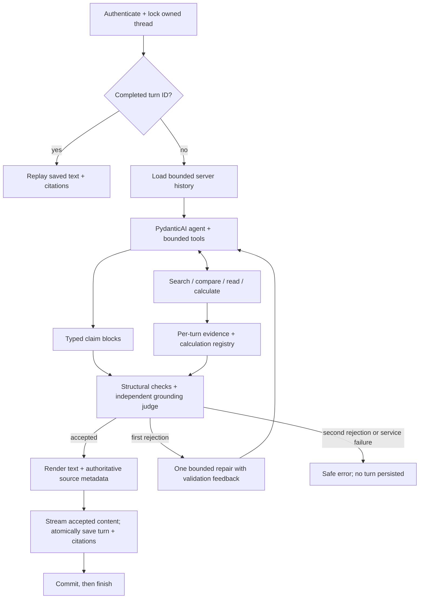

# Phase Six: Grounded Answers Implementation Plan

> **For agentic workers:** Use `superpowers:executing-plans` to implement this plan task by task. Read root, backend, and frontend AGENTS instructions first. Do not commit or push unless the owner requests it.

**Goal:** Replace the stubbed chat response with a PydanticAI agent that produces source-supported answers, calculations, citations, or explicit evidence-gap responses in the existing authenticated browser chat.

**Architecture:** A request-scoped agent uses the phase-5 retriever through bounded tools. The backend checks the resulting typed claims against evidence actually exposed during this turn, independently judges claim support, renders accepted claims, streams them, and atomically persists messages and citations.

**Stack:** Existing FastAPI, PydanticAI 2.54, OpenAI SDK, psycopg, Supabase Postgres, Vite/React, and AI SDK. No new runtime dependencies or database migration is planned.

**Specification:** [Phase 6 checklist](../todos.md), [architecture](../architecture.md), [client brief](../client-brief.md), and the owner decisions recorded below. The tutorial reference is pinned to `d41888da21e03fec2dbb17b9961bef9b67622588` in `daveebbelaar/document-copilot`.

## 1. Decisions and boundaries

The owner selected:

- **Validate first, then stream accepted answer text.** Stream progress during retrieval/generation/validation. Never expose a rejected draft.
- **One grounding repair attempt**, then a controlled failure. Do not retry an entire turn on network/provider failures.
- **Typed cited claim blocks**, rendered by the backend, rather than unrestricted model-written Markdown.
- **A small deterministic calculator now**, using cited numeric inputs with unit/period checks.

Preserve these existing decisions:

- Keep the existing extracted corpus as-is. Page locations and normalized fiscal years remain unverified; do not infer them from filing dates or corpus-year folders.
- Use configured OpenAI models. Development defaults/examples for answering and grounding are `gpt-4o-mini`; do not silently overwrite the owner's `.env`. Query embeddings stay `text-embedding-3-small`, 1536 dimensions.
- Approved users share this public SEC corpus; their chat histories remain private. Document filters are not authorization rules.
- Only the latest question is accepted from the client as new input. Prior conversational context comes from authenticated server-side history.
- Real live-source verification, refusal behavior, and minimal readable source details are part of phase 6. Full Markdown/table rendering, a polished source sidebar, and corpus expansion remain later phases.

## 2. Contracts and trust rules

### Request-scoped dependencies and evidence

Create focused modules under `backend/app/assistant/` for outputs, dependencies, tools, agent setup, and instructions; keep validation under `backend/app/grounding/` and turn coordination under `backend/app/chat/orchestrator.py`.

`DocumentAgentDeps` contains the authenticated user/thread IDs, `DocumentRetriever`, `TurnRegistry`, shared turn budgets, and an optional progress callback. Reuse an explicitly configured async OpenAI client during a turn and close resources on every exit. Do not cache mutable agent dependencies or registries globally.

`TurnRegistry` retains authoritative passage metadata, the exact text spans exposed to the agent, and calculator records. Search results must not register hidden full chunk text as model-visible evidence when the tool only returned a clipped excerpt. Register only emitted excerpts; a later read tool can expose and register additional text. Truncation markers are not source text.

The registry starts empty for every new turn. Prior assistant messages, client-supplied citations, and previous turns' source references are not evidence for the current answer unless the underlying passages are retrieved/read again.

### Typed answers

Define these output concepts in `assistant/outputs.py`:

- `EvidenceRef`: `chunk_id` and an exact supporting quote. Metadata such as ticker, source URL, page, and year is never accepted from the model.
- `AnswerClaim`: plain claim text, kind (`fact`, `calculation`, or `interpretation`), one or more evidence references, and a calculation ID when applicable.
- `EvidenceGap`: optional company/corpus-year target and a bounded reason code (`missing_evidence`, `ambiguous_figures`, `unsupported_causality`, `ambiguous_question`, or `outside_scope`).
- `GroundedAnswer`: status (`answered`, `partial`, or `insufficient_evidence`), ordered claims, and evidence gaps. An answered result needs claims; a partial result needs claims and gaps; an insufficient-evidence result has no claims and at least one gap.

The server renders claims in order, assigns citation indices in first-use order, and deduplicates identical `(chunk_id, normalized quote)` references. Claim text cannot supply its own `[n]` markers. Label calculations and interpretations explicitly. Render gap/refusal explanations from fixed backend wording and validated target labels, rather than allowing uncited factual prose in a refusal.

Each claim block can contain connected factual statements, but the judge must support every part of the block. Typed blocks enforce citation attachment; they do not make semantic support mechanically provable.

### Tools

Expose only these evidence/calculation capabilities to the answering agent:

- `search_filings(query, filters)`: phase-5 hybrid search with typed filters.
- `compare_filings(query, targets)`: explicit target searches through phase-5 `compare`; this makes existing multi-year coverage available to the agent without copying retrieval policy.
- `read_chunk(chunk_id)` and `read_chunks(chunk_ids)`: bounded full-text reads; batch reads accept at most five IDs.
- `read_surrounding_chunks(chunk_id, radius=1)`: existing same-document neighbors, within the configured radius.
- `prepare_calculation(query, filters)`: retrieve bounded source text, enumerate numeric candidates, select and verify two facts, then return ordered fact IDs.
- `calculate(first_fact_id, second_fact_id)`: use only the verified ordered pair from this turn. The operation, amounts, units, periods and quotes are server-owned. No Python execution, arbitrary expressions, generated SQL, filesystem access, or external information tools.

The agent may resolve company/year targets from the question and trusted conversational context, then call typed tools. Unknown/ambiguous targets remain visible; it must not silently substitute a different company or period. Comparison output retains a header and match/gap status for every target before allocating remaining excerpt space. Do not simply clip away later targets.

Every tool response reports relevant warnings and truncation. Limit each response to 12,000 characters, the cumulative evidence text exposed in one turn to 48,000 characters, and unique exposed chunks to 50. Once a limit is reached, return an explicit budget/gap indication; do not silently register unseen text. The model may request a narrower read within the remaining budget.

For comparison formatting, reserve all target headers, statuses, and candidate IDs first. Divide remaining excerpt characters equally among nonempty targets, then allocate each target's share to its primary passages in rank order. Include neighbors only from remaining space. Register only the excerpts that survive this allocation.

## 3. Grounding and calculations

### Structural checks

Before asking the grounding judge, verify:

1. Output status, claims, and evidence gaps obey their typed contracts and configured bounds.
2. Every claim has evidence references; referenced chunks exist in this turn's registry.
3. Every quote is a whitespace-normalized substring of both the authoritative source text and text actually exposed to the agent. Do not use fuzzy matching or allow the model to rewrite numbers inside quotes.
4. Citations get their filing/location metadata only from registry snapshots. Unknown page/fiscal-year values stay unknown.
5. Calculation claims reference a calculator record created in this turn and cite its input evidence.
6. Source text and prior messages cannot introduce instructions, tools, permissions, or altered system policy.
7. An in-scope factual question requires at least one search/compare operation before accepting an answer or missing-evidence refusal. Only controlled outside-scope or clarification replies may bypass retrieval; verify this from tool activity, not the model's assertion.

### Independent support check

Use a separate typed PydanticAI grounding agent with no tools. Send the question, each claim, its cited observed evidence and source metadata, and any calculation record. Require exactly one indexed decision per claim; reject missing, duplicate, extra, or malformed decisions.

The judge must assess entailment, numerical values, units/scales, period binding, company/segment attribution, and unsupported causal leaps. It must reject partially supported compound claims and statements based on outside knowledge. For interpretation blocks it checks that the inference is modest, explicitly labeled, and supported by the cited facts.

A provider failure or malformed judge result is a service/validation failure, not proof of insufficient evidence. A structurally valid no-claim insufficient-evidence response uses controlled refusal text; do not invent a factual explanation to fill it.

If a draft is rejected, give the answering agent the offending claim indices and safe validation reasons for **one** repair attempt. Retain legitimate evidence/calculator records from the same turn and keep budgets cumulative. Validate the entire repaired draft again. After another rejection, emit a safe grounding error and persist neither message nor citations.

### Deterministic calculator

Owner-approved guided refinement (2026-10-19): explicit arithmetic requests cannot
skip preparation or calculate before fact verification. A no-tool selector chooses
server-enumerated candidate IDs; numbers, scales, explicit source period headings
and quotes are not retyped by the model. Independent support checks precede fact
registration. Ordinary lookups retain their tool flow. The current candidate
enumerator supports narrative amounts with explicit annual/quarter headings;
ambiguous tables and chained derivations remain gaps. No corpus cleanup is added.

Support only `ratio_percent`, `percent_change`, and `difference` using `decimal.Decimal`:

- Ratio as a percentage: `100 * numerator / denominator`; numerator/denominator must describe the same company/segment and period, with compatible units; denominator must be positive. This also computes financial margins when the requested input measures support that interpretation.
- Percentage change: `100 * (current - prior) / prior`; require compatible measures, units, and period types, and a positive prior value. Reject zero/negative bases as ambiguous instead of displaying misleading growth rates.
- Difference: subtract compatible values. Differences between percentages are labeled percentage points.

Each operand includes a raw numeric token, normalized Decimal value, measure, company/segment, unit/scale, period label, and supporting evidence references. Verify quotes and numeric-token presence before calculating. Normalize supported currency scales (`USD`, `USD millions`, `USD billions`) explicitly; reject unknown/incompatible units. Parenthesized negatives and comma separators must be parsed deliberately, not evaluated as expressions.

Reject non-finite inputs/results and handle Decimal arithmetic errors as controlled tool failures. Calculate with a local 28-digit precision context. Record the input facts, formula, the Decimal result before display rounding, and a display rounded to two decimals with `ROUND_HALF_UP`. The final grounding check must establish the operands' unit/period/measure binding from the evidence; number presence alone is insufficient. Ambiguous tables trigger a gap/refusal, not an assumed mapping. The server inserts the recorded calculated value into the rendered calculation block; it never trusts a model-computed replacement.

## 4. Chat, persistence, and minimal browser integration

### History and idempotency

Keep `POST /chat/stream`, authentication, thread ownership checks, deterministic message IDs, and per-thread serialization. Preserve the current `FOR UPDATE NOWAIT` behavior; do not introduce a separate locking system in this phase. Retrieval uses its own read-only connections and never shares the locked chat connection concurrently.

Before any paid work, check for a completed turn with the same IDs and question. Extend `completed_turn` to return saved assistant parts/citations as well as text so retries replay the saved result without retrieval, generation, or judging. A reused ID with a different question remains a 409.

For a new turn, load at most the most recent six complete user/assistant pairs, subject to a 12,000-character history cap. Keep complete pairs and discard older pairs first; do not accept prior conversation content from the browser as authoritative history. Prior answers provide conversational context, not evidence. Follow-up claims must re-read/retrieve their support.

### Streaming

Use existing AI SDK SSE framing:

- `start`, then transient `data-status` updates for analyzing/searching/reading/calculating/verifying/repairing.
- After validation, text start/deltas/end and authoritative `data-citation` parts.
- Save the accepted result, commit, then send the final successful `finish` and `[DONE]` events.

Do not add artificial per-word delays. Text is incrementally transmitted after validation; this is not live model-token streaming. A rejected draft emits no text deltas. An accepted text stream remains provisional with respect to durability until commit, preserving the current frontend completion contract.

Monitor disconnects while generation/judging is running, cancel local tasks on Stop/disconnect, close clients, and roll back uncommitted writes. No partial turn is saved. If commit succeeded but the final SSE was lost, retry replays the saved result. Provider-side work already accepted before cancellation may still consume usage; do not promise exactly-once billing.

### Persistence and history

Extend `save_turn` to atomically write the user message, rendered assistant text, final assistant `parts`, and normalized `message_citations` rows in one transaction. Persist validated answered/partial results and controlled insufficient-evidence replies; do not persist transient progress or failed validation results.

Use the existing citation table and JSONB message parts. Store source URL, chunk ID/index, corpus year, nullable fiscal year/page/section, excerpt, and filing dates in authoritative citation parts. The normalized citation rows retain their existing schema. No migration is needed merely to add these part fields.

On reload/replay, reconstruct saved text and citation parts rather than discarding parts and rebuilding text-only messages. Existing stub messages remain legitimate text-only history. The backend owns metadata; ignore client-provided ownership, citation, status, or history assertions.

### Frontend changes limited to phase 6

Add typed status/citation data parts, show live progress, and render a simple numbered source list with expandable excerpts, company/form/year labels and original SEC links. Preserve the existing Stop/retry/reload behavior and clear interrupted in-memory replies on retry. Full Markdown/table styling and the dedicated source sidebar remain phase 7.

## 5. Bounds, diagnostics, and failure behavior

Centralize these defaults in `backend/app/config.py` and document them in `.env.example`:

| Bound | Default |
|---|---:|
| Answering model request budget, cumulative across repair | 20 |
| Answering output-schema retries per attempt | 1 |
| Grounding repair attempts | 1 |
| Tool calls per turn, including failed calls | 12 |
| Search/compare calls within that tool budget | 4 |
| Batch-read chunk IDs | 5 |
| Unique exposed chunks / cumulative exposed text | 50 / 48,000 characters |
| Tool output cap | 12,000 characters |
| Final claims / evidence references per claim | 20 / 5 |
| Answering model maximum output | 3,000 tokens per request |
| Grounding model maximum output | 2,000 tokens per request |
| Overall new-turn deadline | 120 seconds |

The answering request budget includes the numeric selector. Separately account
for phase-5 embedding/keyword usage, at most two numeric-input support checks and
at most two whole-answer grounding runs (four judge requests by default). Numeric
preparation permits grounding-repair-count plus one attempts, normally two.
Retrieval's existing bounded retries and keyword-validation behavior remain in
force. Do not reset budgets for repair or comparison targets.

Log safe IDs, stage durations, model names, request/tool counts, known input/output usage, and failure categories. Never log credentials, raw SDK/driver errors, or full user prompts/source text by default. Keep user-visible errors controlled and distinguish service failure, budget exhaustion, and unsupported evidence.

## 6. Implementation tasks and verification

Implement and verify each task before advancing; write meaningful failing tests first. Preserve unrelated uncommitted ingestion and owner instruction edits. Use the current checkout; no commit/push or data migration is authorized by this plan alone.

### Task 1 — Output contracts and per-turn evidence registry

**Files:** create `assistant/outputs.py`, `assistant/deps.py`, and matching backend tests; extend settings.

- [x] Define the contracts, bounds, source snapshots, observed-text registry, calculation records, and shared usage/progress state described above.
- [x] Test answered/partial/refusal contract violations; missing evidence; unknown years/pages; and hidden text that was fetched but not exposed.
- [x] Test settings reject incompatible limits and empty required model names without revealing secrets.

### Task 2 — Retrieval tools and calculator

**Files:** create `assistant/tools.py` and `assistant/calculations.py`; reuse phase-5 public methods rather than copying SQL.

- [x] Implement bounded search/compare/read tools and fair comparison formatting; register only text actually emitted.
- [x] Implement the three Decimal operations and immutable calculation records.
- [x] Test truncation/registry alignment, one group's text not hiding another target, duplicate passages, unknown IDs, read limits, and cumulative budgets.
- [x] Test negative tokens, non-finite inputs, unit conversion, mismatched periods/segments, zero/negative denominators, rounding, and forged/unseen calculator input evidence.

### Task 3 — Agent and grounding validator

**Files:** create `assistant/agent.py`, `assistant/instructions.md`, and focused `grounding/validator.py` / `grounding/judge.py` modules.

- [x] Build async PydanticAI agents with explicit dependencies and clients; use the installed `retries={"output": 1, "tools": 0}` API where output repair is required.
- [x] Instruct the answering agent to retrieve/read before making claims, preserve year uncertainty, treat documents as untrusted evidence, identify gaps, and avoid stock recommendations or unsupported causality.
- [x] Implement structural checks and one indexed semantic-support decision per claim; give the judge no tools.
- [ ] Test unknown citations, invented quotations, uncited claims, marker injection, conflicting metadata, unsupported numbers/units/periods, partial compound support, and calculator/result tampering.
- [x] Test instruction-like text inside a retrieved source, old-history evidence reuse, and a reference that exists but does not support its claim.
- [x] Test a valid refusal versus a provider error, and reject an in-scope missing-evidence refusal that performed no retrieval; one repair succeeds, repeated rejection fails closed, and usage limits remain cumulative.

### Task 4 — Orchestration and atomic persistence

**Files:** create `chat/orchestrator.py`; update existing chat streaming/API/message contracts and `database/chats.py`.

- [x] Load server-owned bounded history, route completed turns to replay, and run generation/validation with progress and cancellation.
- [x] Render accepted claim blocks and source parts; persist messages/citations atomically and finish only after commit.
- [x] Extend replay/history to preserve citation parts without paid re-generation.
- [x] Test auth/ownership rejection before paid work, forged client history, cross-user access, follow-up context, concurrent requests, reused IDs, and completed retry with zero model calls.
- [x] Test disconnects during tools/judging/text streaming, Stop, deadlines, grounding failure, and citation-insert failure: no incomplete pair or citation rows may survive rollback.
- [x] Add a marked database integration test for atomic message/citation writes and replay; keep ordinary tests network-free.

### Task 5 — Minimal browser source/status support

**Files:** extend existing frontend chat types/history parsing, `ChatConversation`, and `MessageList`; reuse existing UI primitives.

- [x] Show progress without unvalidated answer text; display accepted numbered sources, excerpts, and original links.
- [x] Restore citations after reload and preserve recovery behavior for Stop, F5 and network failure. Owner confirmed the proposed browser checks on 2026-10-19; completed-turn replay and lost-acknowledgement behavior also have backend regression coverage.
- [x] Run TypeScript, lint, and production build. Follow frontend AGENTS: manual browser verification, no frontend test framework.

### Task 6 — Smoke evaluation, owner review, and documentation

**Files:** add `backend/scripts/smoke_assistant.py`, assistant documentation, and an answer-evaluation worksheet under `docs/evaluations/`; update phase-6 todos narrowly.

- [x] Provide a CLI that shows progress, final typed claims, rendered answer, citations, validation decisions, calculations, usage, and timing without saving chats by default. Report safe failures; never expose provider payloads.
- [ ] Run offline suites and marked live checks for a simple Azure lookup, Apple supplier comparison, a supported numerical calculation, an unsupported company/year, and the generative-AI/margins causal question.
- [x] Then run all ten client questions and record actual answer support, evidence gaps, incorrect refusals, citations, calculation validity, latency, and usage. Do not carry phase-5 acceptance forward as answer-quality acceptance.
- [x] Have the owner review one grounded answer, one calculated comparison, and one justified insufficient-evidence reply. Owner accepted the evidence and confirmed all five proposed browser checks on 2026-10-19. Technical quality gates remain separate.

## 7. Completion and known limits

The phase-6 gate passes when an approved user can ask a real browser question,
receive a validated answer or controlled evidence-gap reply, inspect its source
excerpts, reload its history, and retry without duplicate messages/citations or
unnecessary repeat model calls for a completed turn. Rejected drafts are never
shown or persisted. Tests and the owner review must be recorded.

A grounding judge is an additional check, not a mathematical guarantee of truth.
Imperfect financial-table extraction, missing original pages, and unverified
fiscal-year metadata remain visible limitations. Do not silently repair the
corpus or claim those client-brief gaps are solved by adding an agent.

**Status (2026-10-19):** Implementation is present. See the
[execution record](phase-six-progress.md) and [live evaluation](../evaluations/assistant-results.md).
Owner/browser review is complete. The current application calibration and five
marked live checks pass, including the autonomous numerical question. Raw judge
limitations and unresolved broad comparisons remain recorded; the phase gate is
open for claim-support quality rather than additional owner browser work.
